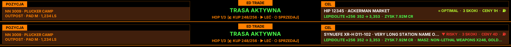
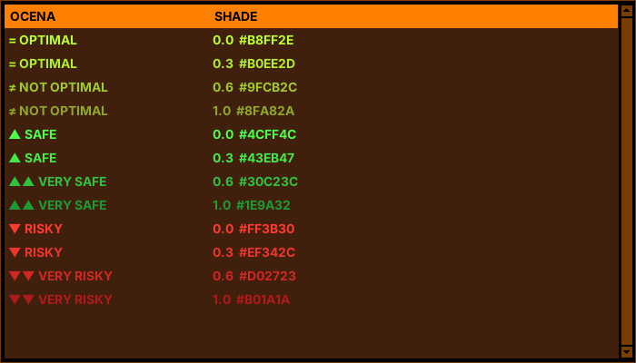
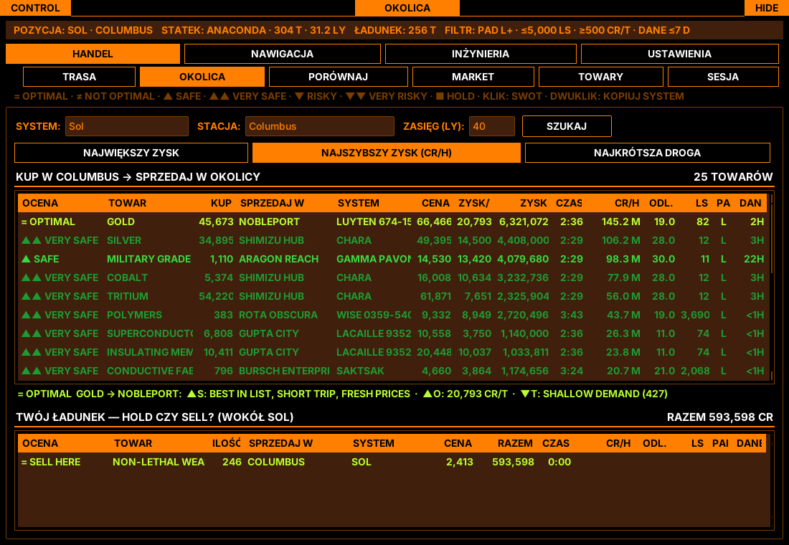
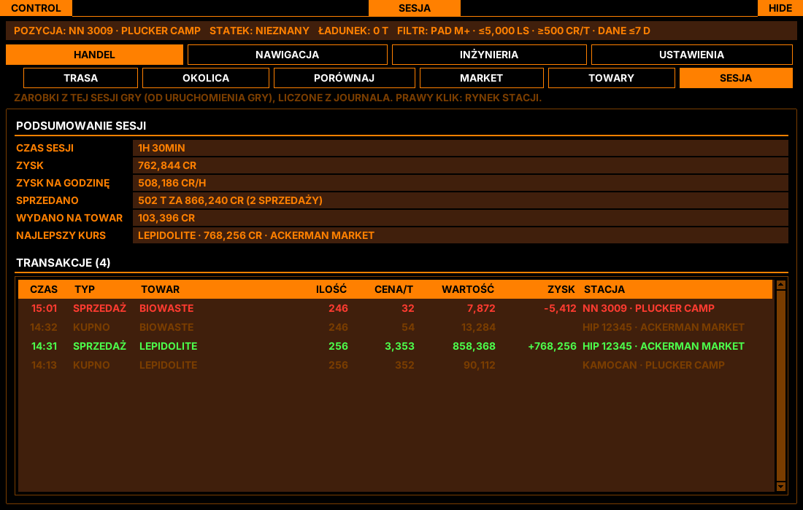
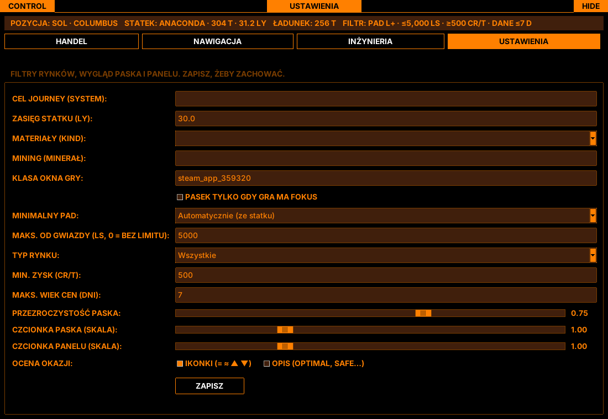

# ED Trade Overlay

[](https://github.com/SyriusM/ed-trade-overlay/actions/workflows/tests.yml)

A trade computer for **Elite Dangerous on Linux (Steam / Proton)** — an always-on-top in-game bar plus a
TCE-style panel. It reads the game journal, knows where you are, what you fly and what is in your hold,
and tells you what to buy, where to sell it and **whether the deal is still worth it** — ranked by credits
per hour, weighted by how fresh the prices are.

Built as a modern replacement for TCE Mk.II (Windows-only, closed source), keeping its look but not its
clunky workflow. The game is never automated: the app only reads the journal and shows information.



## What it does

**Route & live checks**
- Best multi-hop trade route from your station (Spansh), filtered for your ship's pad size, star distance,
  market type, minimum profit/t and maximum price age.
- **Quick route right after docking** — the best single trade from the station market appears in seconds,
  then the full route replaces it when Spansh finishes.
- **Checklist ticks itself** from the journal: buy → fly → sell, hop by hop (`MarketBuy` / `Docked` / `MarketSell`).
- **Live price verification** — when you open the commodity market the game writes `Market.json`; the app
  compares it with the route before you buy: `✓ prices confirmed`, `⚠ buy +15% · stock 120 t`,
  or `✗ commodity gone` → it immediately re-plans from live prices.
- Target **station or system copied to the clipboard** on every route/hop change — paste it into the galaxy map.

**Live rating of every opportunity (SWOT)**



- Six-step scale with colour gradients: `= OPTIMAL`, `≈ NOT OPTIMAL`, `▲ SAFE`, `▲▲ VERY SAFE`, `▼ RISKY`,
  `▼▼ VERY RISKY` — value vs the best option in the list, risk from price age, shallow demand and trip length.
- `▲S / ▼W / ▲O / ▼T` strengths, weaknesses, opportunities and threats for the selected row.
- Your hold: `= SELL HERE`, `► SELL THERE` or `■ HOLD` (no buyer, selling at a loss vs what you paid this
  session, or price well below the galactic average).
- **AUTO profile** (default) picks a strategy per opportunity from its SWOT: low-security or shallow demand → SAFE,
  expensive goods with older prices → RISKY, fresh prices → OPTIMAL.
- **System security** counts in every profile: Low/Anarchy systems lower the score by an adjustable weight, or can be
  skipped entirely; the bar warns when the route target is in a low-security system.
- **Risk profile** can also be fixed manually: SAFE penalises any uncertainty, OPTIMAL prefers
  valuable goods but only with fresh prices, RISKY accepts stale prices only for expensive goods where the reward pays for the risk.



**Your own numbers**
- **Session summary** — profit, real cr/h, tonnage, spend, best run and a trade log from the journal.
- **Your pace** — real trip times are compared with the estimate; after a few runs every cr/h ranking uses
  your actual speed instead of a generic one.



**More panels** — station market with prices vs average, commodity search (best buy/sell nearby), trade
overview (current station | trade advisor | destination), jump route planner, system stations, material
traders, mining hotspots, engineering blueprint shopping list from your materials.



## Running it

Requirements: Linux with X11 (or XWayland), Python 3.12 with Tk, `requests`.

```bash
git clone https://github.com/SyriusM/ed-trade-overlay.git
cd ed-trade-overlay
pip install requests pyzmq      # pyzmq is optional (live EDDN prices)
python -m edtrade.main          # finds the Proton journal folder automatically
python -m edtrade.main --help   # journal dir, capacity, jump range, --no-panel, --no-overlay
```

Run the game in borderless/windowed mode so the bar can stay on top. Settings (filters, bar transparency and
font size, verdict icons/labels, clipboard, risk profile) are saved in `~/.config/ed-trade-overlay/`.

## Data sources

- [Spansh](https://spansh.co.uk) — trade routes and jump routes
- [Ardent Insight](https://ardent-insight.com) — station markets and nearby buyers/sellers
- [EDCD FDevIDs](https://github.com/EDCD/FDevIDs) and [coriolis-data](https://github.com/EDCD/coriolis-data) —
  commodity/material names and blueprints, downloaded at runtime and cached (not redistributed)
- [EDDN](https://github.com/EDCD/EDDN) — live market updates from all players (optional, needs `pyzmq`), stored
  in a local price database with 30 days of history
- Your own game journal, `Cargo.json` and `Market.json`

Elite Dangerous is a trademark of Frontier Developments plc. This is an unofficial fan tool, not affiliated
with or endorsed by Frontier.

## Development

```bash
pip install requests pytest
python -m pytest            # offline: network calls are mocked
```

Code layout: `edtrade/watcher.py` (journal), `trade.py` (APIs, routes, rankings), `assess.py` (SWOT
verdicts), `verify.py` (live price checks), `checklist.py`, `session.py`, `pilot.py` (pace calibration),
`overlay.py` (in-game bar), `panel.py` + `tce_theme.py` (panel UI). Design notes and decisions: `SPEC.md`.
